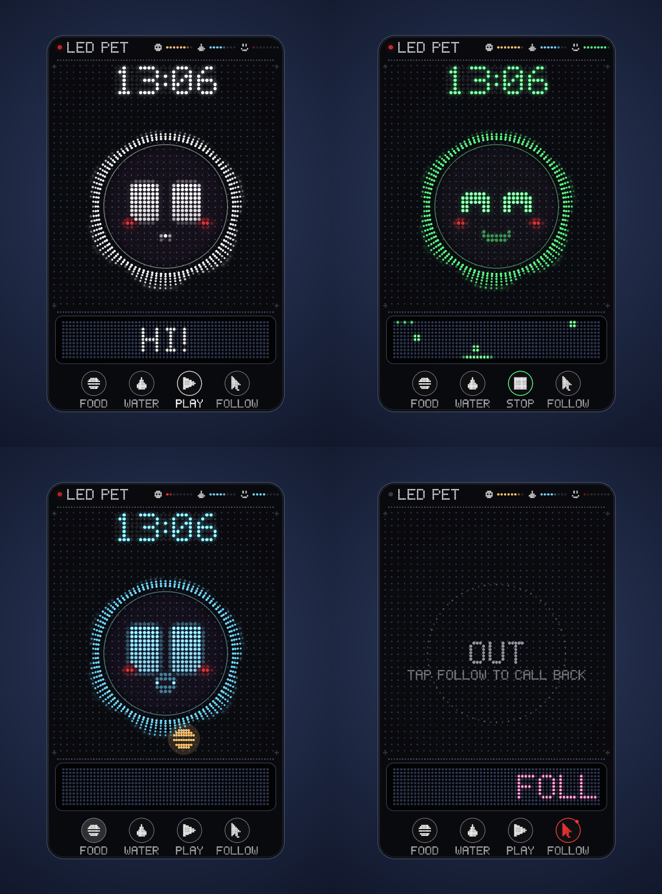

# 🐾 LEDPet

**A little LED-style virtual pet that lives on your Windows desktop.**

LEDPet is a round LED panel with a living dot-matrix face that sits on top of your desktop. It blinks, follows your mouse with its eyes, hatches out of a happy little dot, reacts to your music and changes its whole look with one click — while staying light on your PC.

## ✨ Features

- 🟠 **LED dot-matrix pet** — a round LED panel with a living dot face, inside a Nothing OS style home frame with a real dot-matrix clock
- 🥚 **A real birth** — the pet hatches out of the happy dot: heartbeat, charge-up, burst, springy jelly grow
- 😀 **21 expressions, each with a system-wide hotkey** — they work even while you are inside any other program
- 🎨 **Deep customization** — 11 body shapes, 12 fill styles, 11 dot shapes, 7 themes and a full eye studio (cornea / iris / pupil)
- 🎵 **Audio reactions** — built-in WASAPI engine: equalizer ring + bass-reactive light, nothing to install (both off by default)
- 💾 **Style library** — save your look as a style file, share it, and apply any style with one click (20 ready-made styles included)
- 🖥️ **Always on top, drag anywhere** — mouse-follow mode, edge docking and little needs (food / water / fun)
- 🪶 **Light on your PC** — optimized glow rendering, adaptive frame rate, auto quality on slower systems
- 💽 **Portable** — no install needed: download, extract, double-click

## 🚀 Quick start

**Ready-to-run (recommended)**

1. Download `LEDPet_V1.0_Windows.zip` from [Releases](../../releases)
2. Extract it and double-click **`LEDPet.exe`** — Python not required

**From source**

1. Clone or download this repository
2. Install [Python 3.8+](https://www.python.org/downloads/) (tick *Add python.exe to PATH*)
3. Double-click **`run.bat`** — the launcher installs Pillow + numpy automatically on first start

> The very first start: give your pet a name and watch it hatch. Right-click the pet for the quick menu, or *Advanced settings* for the 8-tab settings window.

## 🎛️ Styles

A style is a small `.json` file that holds a complete look: LED colors, size, body shape, fill, dots, eyes, effects and clock options. Open **Settings → Styles** to:

- click any style in the list to apply it instantly
- save your current look under any name
- import style files from anywhere, export and share your own
- 20 ready-made styles ship with the app (Lava, Ocean, Matrix, Vaporwave, Bubblegum, Retro Panel…)

A style never touches your pet's identity — the name, position, sound switches and shortcuts stay exactly as they are.

## ⌨️ Default shortcuts

| Keys | Expressions |
|------|-------------|
| `Alt+0` | back to the normal face |
| `Alt+1` … `Alt+6` | Happy, Wink, Surprised, Love, Pout, Dizzy |
| `Ctrl+Alt+1` … `Ctrl+Alt+0` | Sad, Cry, Angry, Laugh, Cool, Star eyes, Thinking, Sleepy, Shy, Kiss |
| `Shift+Alt+1` … `Shift+Alt+4` | Smirk, Eating, Drinking, Hungry |

Every shortcut is re-recordable in **Settings → Shortcuts**.

## 🗂️ Where is my data?

All settings live in `%APPDATA%\LEDPet\` (`config.json`, `error.log`) — the program folder stays clean.

## About

LEDPet is a small desktop companion focused on customization, simplicity and fun. The goal is to make your desktop feel a little more alive without getting in the way of your everyday work.

## License

Released under the [MIT License](LICENSE) — made by **THEGEM**.
